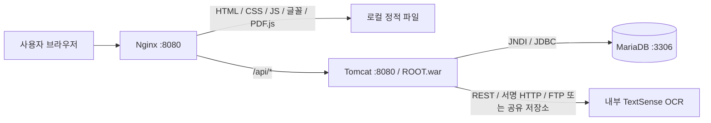

# FormReader Java 제품판

**Nginx / Tomcat / MariaDB 기반으로 문서 인식·검수·내보내기와 업무 기능을 구현한 제품판 개발 버전**입니다. Pilot v1은 별도 태그에 보존합니다. 고객망별 설치·성능·장애 복구 검증을 거쳐 납품 버전을 확정합니다.

| 구분 | Pilot v1 | Java 제품판 |
| --- | --- | --- |
| 소스 기준 | `v1.0.0-pilot.1`, `release/pilot-v1` | `feature/product-web-was-rdb` |
| WEB | Node.js 정적 파일 제공 | Nginx, 기존 HTML/CSS/JS 및 내장 글꼴·PDF.js 재사용 |
| WAS | Node.js | Java 21, Jakarta Servlet 6, Tomcat 10.1, `ROOT.war` |
| RDB | SQLite | MariaDB 11.4, Tomcat JNDI 연결 풀 |
| 계정 | Better Auth + SQLite | Java 인증, 가입 승인·권한·세션·비밀번호 변경을 MariaDB에 저장 |
| 서식 | 등록·수정·이력·복원 | 기존 API와 JSON 구조 유지, 트랜잭션으로 버전 저장·복원, 샘플 PDF·이미지·TIFF와 미저장 서식 OCR |
| 문서 인식 | TextSense 연동 | REST 작업 접수·상태 폴링, 서명 HTTP 입력, 공유 저장소/FTP 결과 수신, 실패 재시도·재처리·취소·재시작 복구 |
| 결과·검수 | 영역·표·반복 데이터 | 영역/행/셀/단어, SearchAPI, 자동 분류·추가 정책 재인식·서식 재적용, 검수 임시 저장·검증·완료 |
| 내보내기 | JSON/XML/TXT/CSV/XLSX/PDF/Markdown | 7종 모두 지원, 검수값 반영, 한글 검색 PDF 및 검수 결과 JSON 첨부, CSV 수식 방지 |
| 업무 기능 | 분리·비교·전송·운영 | 수동/페이지수/빈페이지/서식 경계 분리, 실제 원본 PDF 분리, 텍스트·위치 비교, 업무 전송·재시도·중복 방지, 자원·이력·초기화 |

제품판에는 Node.js 서버를 Tomcat 뒤에 숨겨서 실행하는 구성이 없습니다. 제품 런타임은 Nginx, JVM/Tomcat, MariaDB로 구성합니다. Node.js는 기존 Pilot 실행과 서식 내보내기 작업에서만 사용합니다.



## 빌드 및 실행

빌드 PC에 JDK 21과 Maven이 필요합니다. 최초 빌드는 인터넷 또는 사내 Maven 저장소에서 의존성을 확보합니다.

```powershell
# 저장소 루트에서 실행
./product/scripts/build-offline.ps1
# Maven이 PATH에 없으면 -Maven 'C:/도구/apache-maven/bin/mvn.cmd'
# 캐시만으로 다시 빌드: ./product/scripts/build-offline.ps1 -Offline
```

```sh
sh product/scripts/build-offline.sh
# 캐시만으로 빌드: sh product/scripts/build-offline.sh -o
```

`product/offline`에 WAR, JDBC 드라이버, 화면 파일, 배포 설정, 스키마, SHA256 목록을 모읍니다. 빌드 스크립트는 이미지 다운로드나 서버 실행을 수행하지 않습니다.

인터넷 가능한 준비 PC에서 다음 이미지를 미리 확보합니다. 운영망에서 이미지를 자동으로 받지 않도록 Compose에 `pull_policy: never`를 지정했습니다. 아래 버전은 이번 전환판의 고정 기준이며, 납품 시점의 승인된 보안 패치 버전으로 다시 검증해야 합니다.

```sh
docker pull nginx:1.28.0-alpine
docker pull tomcat:10.1.61-jdk21-temurin
docker pull mariadb:11.4.9
docker image save -o formreader-runtime-images.tar nginx:1.28.0-alpine tomcat:10.1.61-jdk21-temurin mariadb:11.4.9
```

폐쇄망으로 `offline` 폴더와 이미지 TAR를 반입한 뒤:

```sh
docker image load -i formreader-runtime-images.tar
cd offline
sha256sum -c SHA256SUMS
cp .env.example .env
# .env의 초기 설정 토큰·DB 비밀번호·DB 관리자 비밀번호를 각각 다르게 설정
# FORMREADER_PUBLIC_URL을 실제 브라우저 접속 origin과 정확히 일치시킴
docker compose --env-file .env up -d --pull never
```

저장소에서 직접 실행할 때는 `cd product` 후 같은 Compose 명령을 사용합니다. 기본 접속은 `http://localhost:8088`입니다. 최초 `/setup`에서 `.env`에 지정한 **32자 이상의 초기 설정 토큰**으로 관리자를 만듭니다. 토큰은 URL이나 로그에 넣지 않습니다. 최초 설정 후 운영 환경에서 토큰을 제거하거나 교체하고 Tomcat을 재시작할 수 있습니다. 기존 관리자가 있으면 토큰을 알아도 최초 설정을 다시 실행할 수 없습니다.

Docker 사용이 불가능한 납품 환경에서는 동일한 파일을 개별 서버에 배치합니다.

### OCR 입력·결과 경로

- **공유 저장소:** `FORMREADER_INPUT_PUBLIC_URL`을 비우고, Java 서버의 `LOCAL_INPUT_DIR`·`LOCAL_OUTPUT_DIR`과 OCR 서버의 `EPAPYRUS_INPUT_URI`·`EPAPYRUS_OUTPUT_URI`를 같은 파일을 가리키는 공유 마운트로 맞춥니다. Compose의 `documents` 볼륨 경로 `/var/lib/formreader/input`, `/var/lib/formreader/output`을 고객 공유 경로에 추가로 bind mount할 수 있습니다.
- **HTTP 입력 + FTP 결과:** `FORMREADER_INPUT_PUBLIC_URL`을 TextSense에서 접근 가능한 Nginx 내부 주소로 지정하고 `FTP_PUBLIC_HOST`·`FTP_HOST_BIND_ADDRESS`를 서버 내부 주소로 설정합니다. `docker compose -f compose.yaml -f compose.ftp.yaml --env-file .env up -d --pull never`로 수신 포트를 공개합니다. FTP는 실행 시 임의 비밀번호를 생성하며 활성 작업의 결과 JSON만 업로드할 수 있고 다운로드·삭제는 허용하지 않습니다. 실제 엔진이 보내는 `/job_....json` 절대 경로도 루트 내부의 허용된 파일로 처리합니다.
- **네이티브 VPN 검증:** `FORMREADER_INPUT_PUBLIC_URL=auto`와 `FORMREADER_INPUT_PORT`로 OCR 서버로 향하는 현재 로컬 주소의 서명 URL을 생성할 수 있습니다. 해당 포트의 Tomcat Connector를 별도로 구성하면 API 요청은 차단하고 `/files/input/*`만 제공합니다. VPN 주소가 바뀌면 바인딩한 Connector·FTP 주소도 갱신합니다. 포트를 명시하지 않고 `auto`를 사용할 때는 18080 포트가 기본입니다.

WEB·WAS·RDB 및 FTP 수신 포트는 고객망에서 필요한 주소에만 바인딩합니다. Compose의 DB 볼륨과 문서 볼륨은 별도로 영속화됩니다. 원본·OCR JSON·검수/작업 DB를 함께 백업해야 복구할 수 있습니다.

### 개별 서버 설치

1. Nginx 서버: `web`을 `/opt/formreader/web`에 배치하고 `deploy/nginx.conf`의 upstream `tomcat:8080`을 실제 WAS 주소로 수정합니다. Nginx에 `http_auth_request_module`이 필요합니다.
2. Tomcat 서버: 전용 `CATALINA_BASE`와 비어 있는 `webapps`에 `ROOT.war`를 배포합니다. 배포판에 기본으로 들어 있는 `webapps/ROOT`가 있으면 기본 ROOT가 선택될 수 있으므로 기존 배포는 `appBase` 밖으로 백업합니다. JDK 21, Tomcat 10.1을 사용하고 `lib`의 MariaDB JDBC JAR를 `$CATALINA_HOME/lib`에, `deploy/ROOT.xml`을 `$CATALINA_BASE/conf/Catalina/localhost/ROOT.xml`에 배치합니다.
3. `deploy/server.xml`을 검토·적용하고 Tomcat에 `FORMREADER_PUBLIC_URL`, `FORMREADER_SETUP_TOKEN`, `DB_HOST`, `DB_PORT`, `DB_NAME`, `DB_USER`, `DB_PASSWORD`를 설정합니다. `CATALINA_OPTS`에 `-Dorg.apache.tomcat.util.digester.PROPERTY_SOURCE=org.apache.tomcat.util.digester.EnvironmentPropertySource`를 추가합니다.
4. DB 관리자가 전용 UTF-8 데이터베이스를 생성하고 `db/V001__product.sql`을 **한 번만** 적용합니다. 애플리케이션 계정에는 해당 DB의 `SELECT, INSERT, UPDATE, DELETE` 권한만 부여할 수 있습니다. 기본 MariaDB 이미지의 자동 생성 계정은 해당 DB의 전체 권한을 가지므로 납품 구성에서는 권한을 줄입니다.
5. WEB→WAS 8080, WAS→RDB 3306만 필요한 경로에 허용합니다. `RemoteIpValve`의 신뢰 프록시 주소도 실제 Nginx 주소로 제한합니다. 운영 접속에 HTTPS를 구성하고 `FORMREADER_PUBLIC_URL=https://...`로 설정하면 세션 쿠키에 `Secure`가 적용됩니다. 예시 Nginx 설정은 로컬 검증용 HTTP입니다.

DB는 컨테이너 외부에 포트를 공개하지 않으며 named volume에 보관합니다. 초기 SQL은 **비어 있는 DB 볼륨에서만** 자동 실행됩니다. 이미 사용 중인 볼륨은 관리자가 마이그레이션하며, 재시작으로 스키마가 다시 적용되지는 않습니다. 애플리케이션은 런타임 DDL이나 외부 다운로드를 수행하지 않습니다. DB 백업과 원본·결과 파일 백업은 별개입니다.

## Pilot 보존과 데이터 이전

Pilot 실행: 별도 디렉터리에 `git worktree add ../formreader-pilot-v1 release/pilot-v1` 후 `npm ci` 및 기존 `.env`·데이터 설정으로 실행합니다. 태그에는 계정 DB, 원본 문서, `.env`, VPN 파일이 포함되지 않습니다. 기존 `data`와 `.env`는 원래 위치에 유지되므로 필요하면 별도로 백업해야 합니다. Pilot과 제품판은 데이터 경로와 DB를 공유하지 않습니다.

현재 데이터 이전 도구는 **서식과 서식 버전만** 읽기 전용으로 내보냅니다.

```sh
node product/scripts/export-pilot.script.js data/workspace.sqlite outputs/pilot-templates.sql
# 제품 WAS를 중지하고 빈 제품 DB에 V001 적용 후 실행. --force 옵션 사용 금지.
mariadb --host=DB호스트 --user=관리자 -p 제품DB < outputs/pilot-templates.sql
```

파일 ID·서식 ID·JSON 구조는 보존하며 중복 키가 있으면 SQL 가져오기를 중단합니다. 인코딩과 SQL 특수문자를 보존하기 위해 문자열은 UTF-8 HEX로 내보냅니다. 계정·세션·연동 토큰·작업·검수·샘플·원본 파일은 포함되지 않습니다. 샘플 ID는 참조값만 유지하며 샘플 기능이 이전될 때 파일을 함께 반입해야 합니다. **기존 Pilot 계정의 자동 이전은 구현하지 않았으므로 제품판에서 관리자를 만들고 사용자는 다시 가입해야 합니다.** 비밀번호 해시 형식은 Pilot과 호환되지 않습니다.

## 검증

이번 실행 결과와 환경 제약은 [검증 기록](VERIFICATION.md)에 정리했습니다.

```sh
mvn -B -ntp -f product/was/pom.xml test
node --test product/scripts/export-pilot.test.js
# 반드시 테스트 전용 빈 제품 DB에서 실행. 관리자·사용자·서식을 생성하고 상태를 변경합니다.
# PRODUCT_TEST_ORIGIN=http://localhost:8088 및 FORMREADER_SETUP_TOKEN을 테스트 환경에 설정
node --test product/scripts/smoke.test.js
# 별도 테스트 Tomcat/MariaDB 및 FTP 수신기를 구성하고, TEXTSENSE_BASE_URL을
# 이 스크립트가 실행하는 로컬 mock 게이트웨이(기본 18377)에 맞춘 상태에서 실행.
# 원본·작업·서식을 생성하고 마지막에 테스트 문서를 초기화하므로 테스트 전용 DB만 사용.
node --test product/scripts/full-flow.test.js
# Pilot 알고리즘의 결과를 재생성한 뒤 Java와 비교하는 17개 고정 사례
node product/scripts/build-parity-fixtures.script.js
```

`/api/health`는 WAS 생존 확인, `/api/ready`는 MariaDB 스키마 연결 확인입니다. 인증·서식 동작, 초기 설정 토큰·origin 제한, 가입 승인·권한, 세션 만료·해제, 비밀번호 변경, 트랜잭션·동시 버전 증가·복원, 로컬 PDF.js MIME을 검증합니다. 기존 `npm test`는 Pilot 회귀 검증입니다.

## 남은 납품·마이그레이션 작업

1. Pilot의 기존 작업·파일·계정을 새 제품판으로 일괄 이전하는 전용 도구. 현재 계정은 재가입, 서식·버전만 도구로 이전합니다.
2. 고객망 OS·승인 버전·컨테이너 허용 여부·공유 저장소·포트 정책에 맞춘 납품 패키징과 장시간 부하·운영 검증.
3. 다중 WAS 간 작업 소유권·세션·큐 조정. 현재 OCR 작업 실행은 단일 Tomcat 인스턴스 기준이며 재시작 시 진행 작업을 실패로 보존하고 재처리합니다.

정규식은 Java `Pattern` 기준이며 JavaScript 전용 문법의 동일 동작은 보장하지 않습니다. OCR 엔진 자체 취소 API를 설정하지 않으면 취소는 앱의 후속 처리 중단입니다. 선택 페이지 인식은 원본 페이지 번호를 유지합니다. 검색 PDF는 원본 페이지 위에 원래 OCR 텍스트를 보이지 않게 추가하고, 사람이 수정한 항목·반복 행은 첨부 JSON에 보관합니다. JSON/XML/CSV/XLSX/Markdown에는 검수값이 반영되며 TXT는 검수 본문이 있으면 이를 사용합니다.

설계 근거: [Tomcat 10.1 / Servlet 6](https://tomcat.apache.org/tomcat-10.1-doc/index.html), [Tomcat JNDI DataSource](https://tomcat.apache.org/tomcat-10.1-doc/jndi-datasource-examples-howto.html), [MariaDB Connector/J](https://mariadb.com/docs/connectors/mariadb-connector-j/about-mariadb-connector-j), [Nginx reverse proxy](https://nginx.org/en/docs/http/ngx_http_proxy_module.html).
